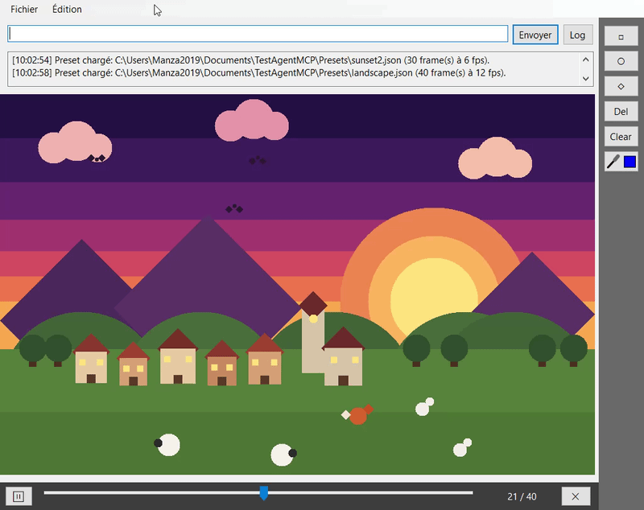
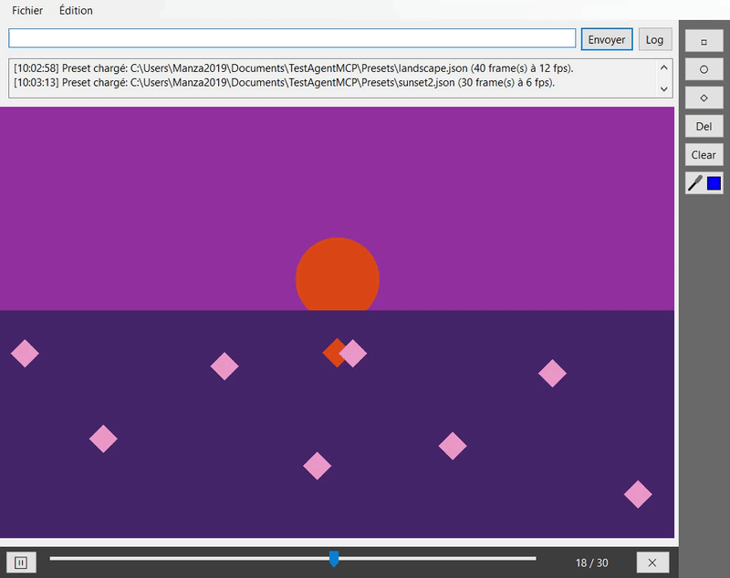

# TestAgentMCP

App WinForms (.NET 10) de formes (carrés, cercles, losanges) pilotable à la souris, par prompt (OpenAI) ou par un client MCP externe comme Claude Code.

## Serveur MCP

Au démarrage, l'app expose un serveur MCP (Streamable HTTP) sur `http://localhost:3333/mcp`, accessible uniquement en local.

Outils :
- `get_canvas_state` : lit la zone de dessin (`DrawingLeft/Top/Width/Height`), les formes `{Id, X, Y, Size, Color, Shape}` et l'état de l'animation (`FrameCount`, `CurrentFrame`, `IsPlaying`, `Fps`).
- `apply_square_updates` : `action` = `Add` | `Update` | `Remove`, `infos` = liste de `{id, x, y, size, color, shape}`. Retourne le nouvel état.
- `set_animation` : `frames` = liste (2 à 50) de listes de `{id, x, y, size, color, shape}`, `fps` optionnel (défaut 15). Chaque frame s'applique en Update sur la précédente (la première part de l'état courant), il suffit donc de lister ce qui change. L'animation joue en boucle ; `frames: []` la supprime.

Connexion depuis Claude Code (app lancée) :

```bash
claude mcp add --transport http shapes http://localhost:3333/mcp
```

Le fichier `.mcp.json` à la racine fait la même chose pour ce projet.

## Utilisation

- **Souris** : déplacer et modifier les formes directement sur le canvas.
- **Annuler** : Ctrl+Z (10 états max, modifications MCP comprises).
- **Animation** : lecteur avec slider et lecture/stop. En animation, l'édition à la souris modifie la frame affichée. Boutons « + » (ajoute une copie de la frame affichée après elle) et « 🗑 » (supprime la frame affichée).
- **Presets** : menu Fichier pour enregistrer/charger la scène (et son animation) en JSON, dans `Documents\TestAgentMCP\Presets`.

## Exemples

Le dossier [`Presets/`](Presets/) contient des scènes animées : `dog.json`, `landscape.json`, `stonehenge.json`. Les copier dans `Documents\TestAgentMCP\Presets` pour les ouvrir depuis le menu Fichier.

## Démo

Ces deux animations ont été créées uniquement via des prompts MCP, « en aveugle » : le client (Claude Code / sous-agent `shapes-agent`) n'a ni accès au code ni aux fichiers de l'app et ne la connaît qu'à travers ce que le serveur MCP expose (outils, instructions et documentation).





## Clé OpenAI (agent par prompt)

La clé n'est jamais embarquée dans la build. Au premier prompt, l'app la demande puis la stocke chiffrée (DPAPI, compte Windows courant) dans `%LocalAppData%\TestAgentMCP\openai.key` ; la variable `OPENAI_API_KEY` est aussi lue. Une clé refusée (401) est supprimée et redemandée.

## Développement

```bash
dotnet build TestAgentMCP/TestAgentMCP.csproj
```

Fermer l'app avant de compiler, sinon l'exe est verrouillé.

- `Forms/MainForm.cs` : UI et état des formes ; `Forms/MainForm.Designer.cs` : tous les contrôles (vue Conception de Visual Studio).
- `Forms/MainForm.Animation.cs`, `Forms/MainForm.Presets.cs` : logique de l'animation et des presets.
- `Mcp/Common/` : `McpServer` (outils, resources, `get_help`), `McpToolDefinitions`, `CanvasModels`, `McpDocs` ; `Mcp/Local/` : `LocalMcpClient` + `LocalMcpTransport` (agent OpenAI) ; `Mcp/Remote/HttpMcpHost.cs` : transport HTTP.
- `Agent/AgentMCP.cs` : agent OpenAI.
